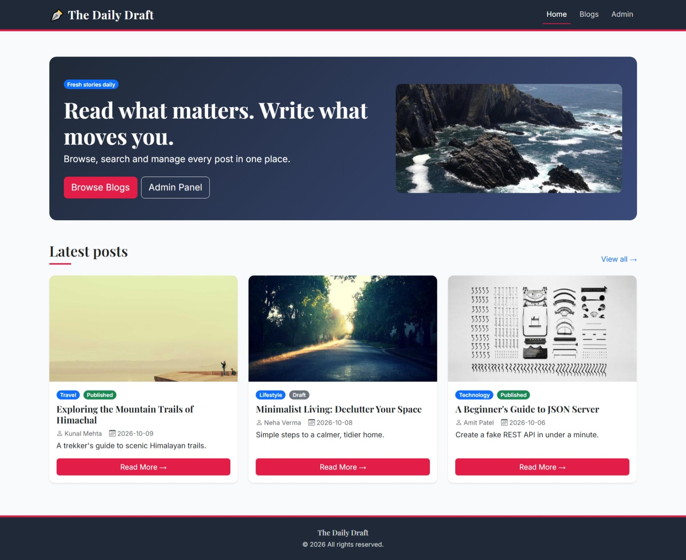
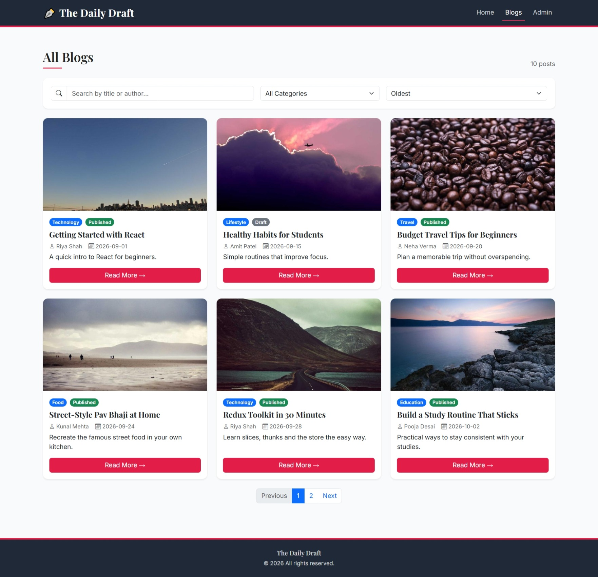
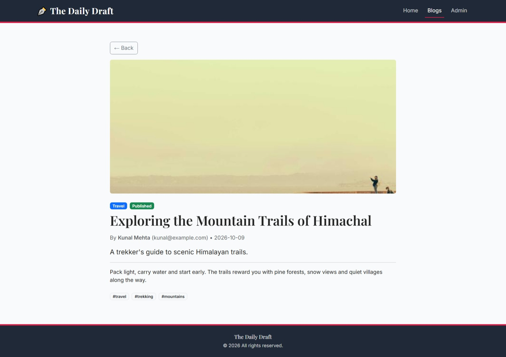
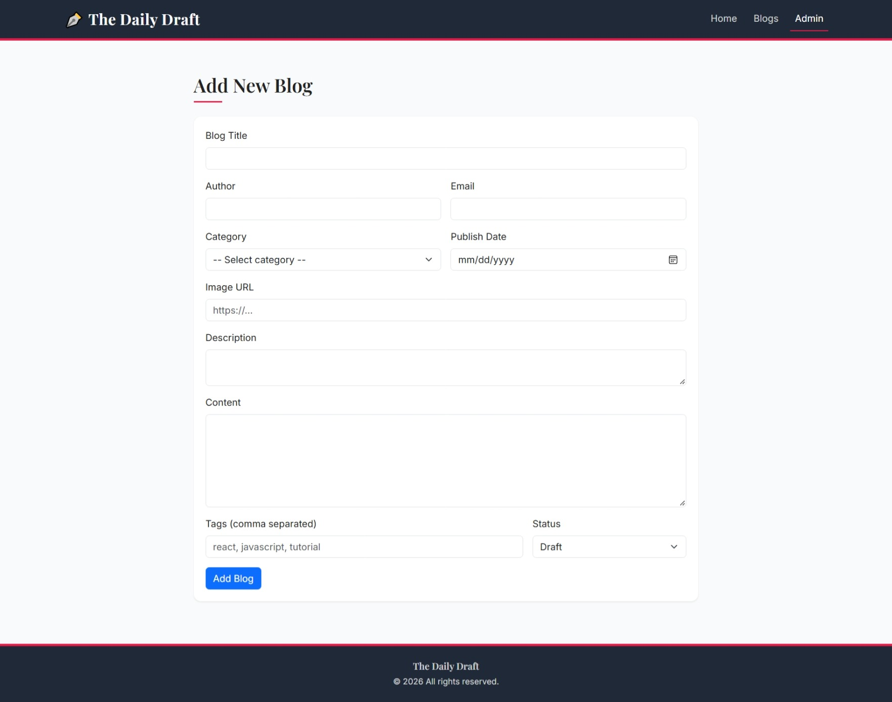
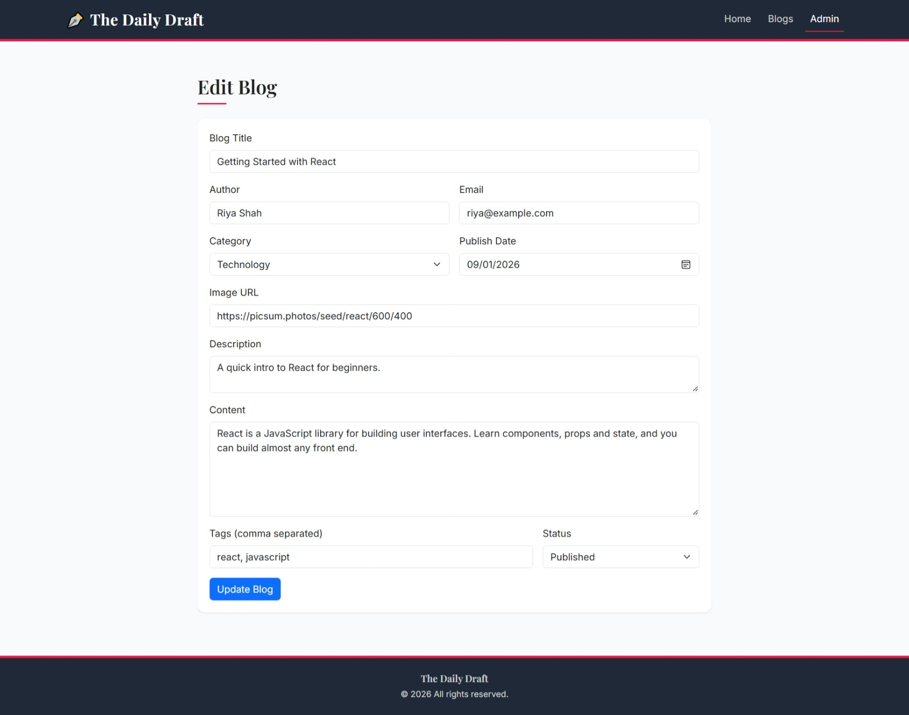
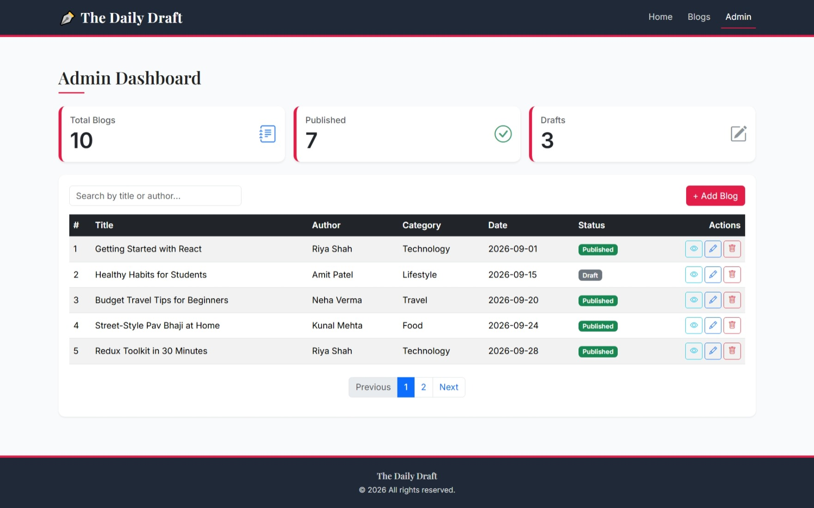

<div align="center">

# 📝 Project : Blog Management System

**The Daily Draft - a responsive React-based Blog Management System with CRUD operations, Redux Toolkit state management, search, filtering, sorting, pagination, form validation, routing, and JSON Server API integration.**

</div>

---

## 📑 Table of Contents

* [Project Description](#-project-description)
* [How This Project is Made](#-how-this-project-is-made)
* [Features](#-features)
* [Technologies Used](#-technologies-used)
* [React Concepts Covered](#-react-concepts-covered)
* [How It Works](#-how-it-works)
* [Search, Sort, Filter & Pagination](#-search-sort-filter--pagination)
* [Form Validation](#-form-validation)
* [CRUD Operations](#-crud-operations)
* [Project Flow](#-project-flow)
* [Routes](#%EF%B8%8F-routes)
* [Project Structure](#-project-structure)
* [Dashboard](#-dashboard)
* [UI Design](#-ui-design)
* [Getting Started](#-getting-started)
* [Screenshots](#-screenshots)
* [Demo](#-demo)
* [Author](#-author)

---

## 📌 Project Description

Blog Management System (branded as **The Daily Draft**) is a responsive React application developed to practice and demonstrate important React concepts such as components, JSX, props, state, hooks, forms, validation, routing, CRUD operations, API integration, Redux, searching, sorting, filtering, and pagination.

The application allows users to browse available blog posts, search blogs by title or author, filter them by category, sort them, view complete blog details, and navigate through paginated results.

An admin dashboard is also provided for managing blog records. Administrators can view blog statistics, add new blogs, edit existing blogs, delete blogs, and search through the records.

The project uses **JSON Server** as a simple backend API and **Axios** for HTTP requests. **Redux Toolkit** is used to maintain and update the blog state throughout the application.

The interface is designed using **Bootstrap 5** and **Bootstrap Icons**, with a clean editorial-style theme featuring charcoal, rose, and soft gray colors.

---

## 🚀 How This Project is Made

This project is built using **React**, **Bootstrap**, **Redux Toolkit**, **Axios**, and **JSON Server**.

### 🧱 Component Structure

The application is divided into reusable components and pages.

### Main Components

* **Header** – Sticky navigation bar with links to Home, Blogs, and Admin.
* **Footer** – Displays application branding and footer information.
* **BlogCard** – Displays an individual blog in a reusable card layout.
* **BlogForm** – Reusable form used for both adding and editing blogs.
* **SearchBar** – Search box, category filter, and sort dropdown for the blog list.
* **Pagination** – Handles page navigation and displays pagination controls.

### Main Pages

* **Home** – Landing page with a hero section and the latest posts.
* **Blogs** – Displays all available blogs in a responsive grid.
* **BlogDetails** – Displays the complete information of a selected blog.
* **Dashboard** – Admin area for managing blog records.
* **AddBlog** – Allows administrators to create a new blog.
* **EditBlog** – Allows administrators to update an existing blog.

---

## ✨ Features

* Responsive editorial-style UI
* Home landing page with latest posts
* Blog listing page
* Individual blog details page
* Admin dashboard with statistics
* Add blog functionality
* Edit blog functionality
* Delete blog functionality (with confirmation)
* Search by title or author
* Category filtering
* A-Z sorting
* Z-A sorting
* Latest-to-oldest sorting
* Oldest-to-latest sorting
* Pagination on the blog list and the dashboard
* Form validation with inline error messages
* Blog status management (Published / Draft)
* Redux Toolkit state management with async thunks
* Axios API integration
* JSON Server backend
* React Router navigation with a 404 page
* Filters remembered using LocalStorage
* Responsive Bootstrap design
* Loading and error states

---

## 🔧 Technologies Used

### Frontend

* React
* JavaScript ES6+
* React Router DOM
* Redux Toolkit and React Redux
* Axios
* Bootstrap 5
* Bootstrap Icons

### Backend

* JSON Server
* REST API

### Development Tools

* Vite
* npm
* Git
* GitHub

---

## 📚 React Concepts Covered

This project demonstrates the following concepts:

### Components

Reusable functional components are used throughout the application, including `Header`, `Footer`, `BlogCard`, `BlogForm`, `SearchBar`, and `Pagination`.

### Props

Props are used to pass blog data and callback functions between components.

For example, `BlogCard` receives a `blog` object, `SearchBar` receives the current filter values and change handlers, and `BlogForm` receives the initial blog data, a submit handler, and the button text.

### State

React `useState` is used to manage:

* Form data, validation errors, and touched fields
* Search text
* Selected category
* Sorting option
* Current page

### useEffect and useMemo

`useEffect` is used for operations such as:

* Fetching blog data from the API when the app loads
* Resetting the page number when filters change
* Saving filter choices to LocalStorage

`useMemo` is used to efficiently compute the filtered, sorted, and categorized blog lists.

### Event Handling

The project handles events such as:

* Form submission
* Input changes and blur events
* Search changes
* Filter changes
* Sort changes
* Pagination clicks
* Edit and delete actions

### Conditional Rendering

Conditional rendering is used for:

* Loading spinners
* Error messages
* Empty blog lists
* "Blog not found" pages
* Published and Draft badges
* Pagination controls

### Redux Toolkit

* `createSlice` for the blog reducer
* `createAsyncThunk` for fetch, add, update, and delete requests
* `configureStore` and `Provider` to connect the store to the app
* `useSelector` and `useDispatch` inside components

### Routing

* `BrowserRouter`, `Routes`, and `Route`
* `NavLink` and `Link` for navigation
* `useParams` for reading the blog ID
* `useNavigate` for redirects after add and update

### Other Concepts

* Controlled components and form handling
* Array methods such as `map`, `filter`, `sort`, and `find`
* Spread operator, rest operator, and destructuring
* LocalStorage

---

## 🔄 How It Works

### 🏠 Home

The Home page acts as the landing page of the application.

It introduces the Blog Management System and provides navigation to:

* Browse Blogs
* Admin Panel

Below the hero section, the three latest posts are displayed using the reusable `BlogCard` component, with a link to view all blogs.

---

### 📚 Blog List

The blog data is fetched from the JSON Server API when the app loads and stored in Redux.

Each blog is displayed using the reusable `BlogCard` component.

A user can:

* Search blogs by title or author
* Filter by category
* Sort the blogs
* Browse blog cards
* Open a complete blog
* Navigate through multiple pages

The blog list is responsive and adapts to different screen sizes.

---

### 📖 Blog Details

When a user selects a blog, React Router navigates to:

`/blogs/:id`

The blog ID is obtained using `useParams`, and the matching blog is found in the Redux store.

The page displays:

* Blog title
* Author and email
* Publish date
* Category
* Description
* Full content
* Tags
* Blog image
* Status

---

### 🛠️ Admin Dashboard

The Dashboard is the main management area for administrators.

It displays blog statistics such as:

* Total Blogs
* Published Blogs
* Draft Blogs

The dashboard also provides controls for:

* Searching by title or author
* Adding blogs
* Viewing blogs
* Editing blogs
* Deleting blogs
* Pagination

The statistics are calculated from the Redux state, so they update instantly after every add, edit, or delete.

---

### ➕ Add Blog

The Add Blog page uses the reusable `BlogForm` component.

The administrator can enter:

* Blog Title
* Author
* Email
* Category
* Image URL
* Description
* Content
* Tags
* Publish Date
* Status

After validation, the blog is submitted to the JSON Server API using an HTTP POST request.

The new blog is then added to the Redux store and the administrator is redirected back to the Dashboard.

---

### ✏️ Edit Blog

The Edit Blog page uses the route:

`/admin/edit/:id`

The application finds the selected blog using its ID.

The existing data is loaded into the reusable `BlogForm`.

After making changes, the administrator can submit the form.

An HTTP PUT request updates the blog on the server, and the updated blog is also reflected in the Redux store.

---

### 🗑️ Delete Blog

The Dashboard provides a delete action for each blog.

When the administrator deletes a blog:

1. A confirmation prompt is shown.
2. The blog ID is identified.
3. A DELETE request is sent to the API.
4. The blog is removed from the Redux store.
5. The dashboard and statistics update automatically.

---

## 🔍 Search, Sort, Filter & Pagination

### Search

Users can search blogs by:

* Blog title
* Author name

The search input dynamically filters the displayed blog collection.

### Category Filter

Blogs can be filtered based on their category.

Examples include:

* Technology
* Lifestyle
* Travel
* Food
* Education
* Health

### Sorting

The blog list supports multiple sorting options:

* Latest
* Oldest
* Title A-Z
* Title Z-A

### Pagination

Pagination divides the blog collection into smaller pages.

The pagination component provides:

* Previous button
* Page numbers
* Next button

The blog list shows 6 blogs per page, and the dashboard shows 5 records per page. The page automatically resets to 1 whenever the search, filter, or sort changes.

### LocalStorage

The selected search text, category, and sort option on the Blogs page are saved in LocalStorage, so they are restored after a page refresh.

---

## 📝 Form Validation

The reusable `BlogForm` validates the information before submitting a blog.

Validation includes:

* Required blog title (minimum 5 characters)
* Required author
* Required and valid email
* Required category
* Required image with a valid `http` or `https` URL
* Required description (minimum 10 characters)
* Required content (minimum 30 characters)
* At least one tag
* Required publish date

Error messages appear below each field after the user leaves it or tries to submit. If validation fails, the form is not submitted.

The same form component is reused for both:

* Adding blogs
* Editing blogs

This avoids unnecessary duplication.

---

## 🔄 CRUD Operations

The project demonstrates all four major CRUD operations.

| Operation | Purpose               | API Method |
| --------- | --------------------- | ---------- |
| Create    | Add a new blog        | POST       |
| Read      | Retrieve blogs        | GET        |
| Update    | Edit an existing blog | PUT        |
| Delete    | Remove a blog         | DELETE     |

Axios is used inside Redux Toolkit async thunks to communicate with the JSON Server REST API.

---

## 📂 Project Flow

```text
                    Blog Management System
                              |
              +---------------+---------------+
              |                               |
            User                            Admin
              |                               |
       +------+-------+              +--------+--------+
       |              |              |        |        |
      Home          Blogs        Dashboard   Add      Edit
                       |              |       Blog     Blog
              Search/Sort/Filter/    CRUD
                 Pagination           |
                       |           Search +
                  Blog Details    Pagination
```

---

## 🛣️ Routes

| Route             | Page         | Purpose               |
| ----------------- | ------------ | --------------------- |
| `/`               | Home         | Landing page          |
| `/blogs`          | Blogs        | Display all blogs     |
| `/blogs/:id`      | Blog Details | Display selected blog |
| `/admin`          | Dashboard    | Manage blogs          |
| `/admin/add-blog` | Add Blog     | Create blog           |
| `/admin/edit/:id` | Edit Blog    | Update blog           |
| `*`               | 404          | Page not found        |

---

## 📂 Project Structure

```text
blog-app/
│
├── src/
│   ├── assets/
│   │   ├── output/
│   │   │   ├── addblog.jpeg
│   │   │   ├── allblogs.jpeg
│   │   │   ├── blogdetails.jpeg
│   │   │   ├── dashboard.jpeg
│   │   │   ├── editblog.jpeg
│   │   │   └── home.jpeg
│   │   └── hero.png
│   │
│   ├── components/
│   │   ├── BlogCard.jsx
│   │   ├── BlogForm.jsx
│   │   ├── Footer.jsx
│   │   ├── Header.jsx
│   │   ├── Pagination.jsx
│   │   └── SearchBar.jsx
│   │
│   ├── pages/
│   │   ├── admin/
│   │   │   ├── AddBlog.jsx
│   │   │   ├── Dashboard.jsx
│   │   │   └── EditBlog.jsx
│   │   │
│   │   ├── BlogDetails.jsx
│   │   ├── Blogs.jsx
│   │   └── Home.jsx
│   │
│   ├── redux/
│   │   ├── store.js
│   │   └── blogSlice.js
│   │
│   ├── App.jsx
│   ├── index.css
│   └── main.jsx
│
├── db.json
├── package.json
├── vite.config.js
└── README.md
```

---

## 📊 Dashboard

The Dashboard provides an overview of the blog collection.

Example statistics:

```text
┌─────────────────┬─────────────────┬─────────────────┐
│   Total Blogs   │   Published     │     Drafts      │
│       25        │       20        │        5        │
└─────────────────┴─────────────────┴─────────────────┘
```

Administrators can also:

* Add a new blog
* Search blogs
* View blogs
* Edit blogs
* Delete blogs
* Navigate using pagination

---

## 🎨 UI Design

The application uses a clean editorial visual theme.

### Main Colors

* **Charcoal** – `#1f2937`
* **Slate** – `#374151`
* **Rose** – `#e11d48`
* **Deep Rose** – `#be123c`
* **Soft Gray** – `#f9fafb`

The design uses:

* Serif typography (Playfair Display) for headings and Inter for body text
* Rounded cards with hover effects
* Sticky navigation bar with a rose accent line
* Pill-style status and category badges
* Bootstrap Icons
* Responsive grid layouts
* White content panels with soft shadows

---

## ⚙️ Getting Started

### Prerequisites

* Node.js (v18 or higher)
* npm

### Installation

```bash
# 1. Clone the repository
git clone https://github.com/YOUR-USERNAME/YOUR-REPO.git
cd YOUR-REPO

# 2. Install dependencies
npm install
```

### Run the Project

The project needs two terminals running at the same time.

```bash
# Terminal 1 - start JSON Server (API on http://localhost:3001)
npm run server

# Terminal 2 - start the React app (http://localhost:5173)
npm run dev
```

### Available Scripts

| Script           | Description                          |
| ---------------- | ------------------------------------ |
| `npm run dev`    | Starts the Vite development server   |
| `npm run server` | Starts JSON Server using `db.json`   |
| `npm run build`  | Creates a production build           |

---

## 📸 Screenshots

### Home



### Blog List



### Blog Details



### Add Blog



### Edit Blog



### Dashboard



---

## 🎬 Demo

|                  |                                     |
| ---------------- | ----------------------------------- |
| 🔗 Live Demo     | [Add your live demo link here](#)   |
| 💻 Project Video | [Add your project video link here](#) |

---

## 💻 Author

<div align="center">

**Your Name**

[](https://github.com/your-username)

⭐ Thank you for visiting this repository!

</div>